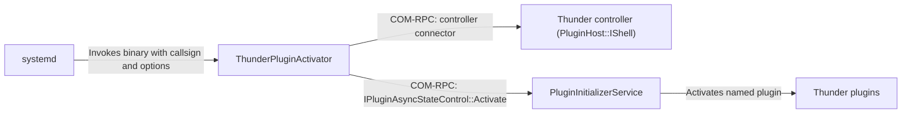
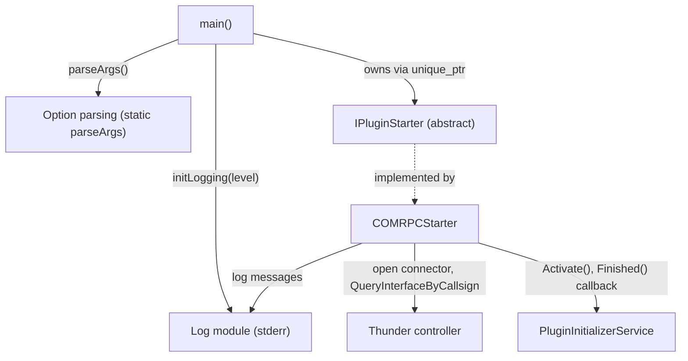
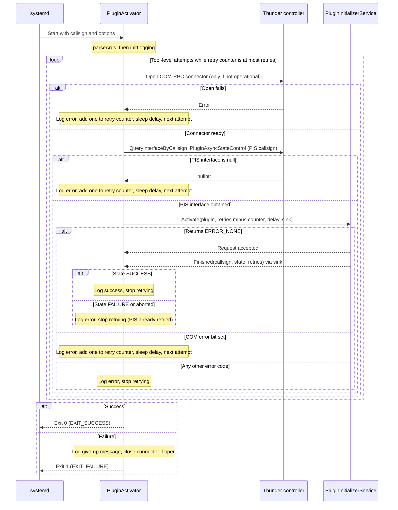
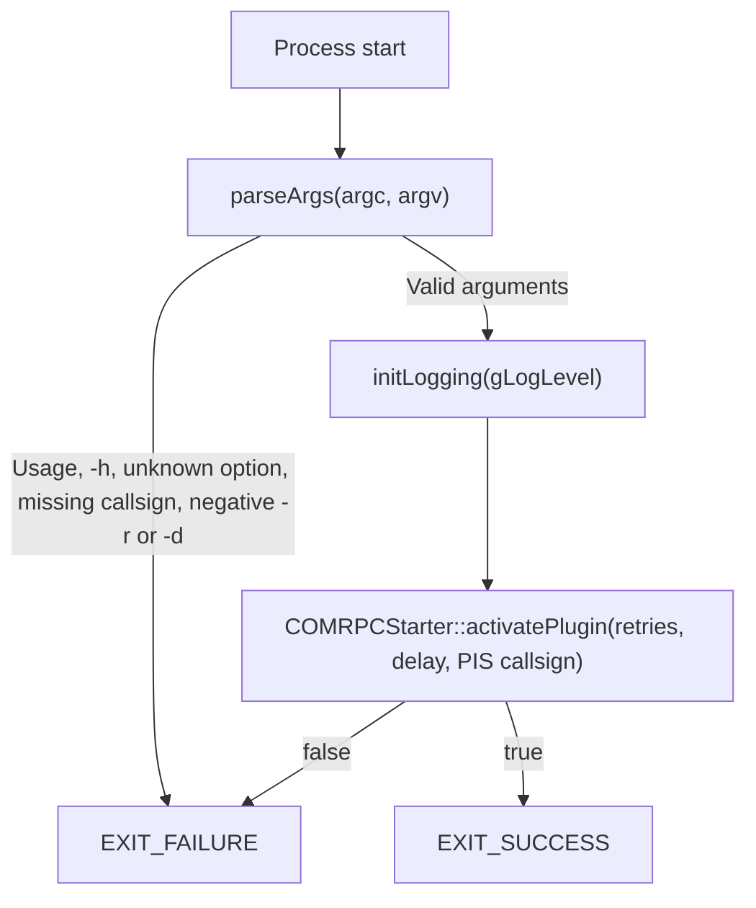

# ThunderPluginActivator

ThunderPluginActivator is a command-line utility for the RDK middleware stack that activates a Thunder (WPEFramework) plugin. It connects to the running Thunder process over COM-RPC, obtains the controller's `PluginHost::IShell`, locates the PluginInitializerService (PIS) by callsign, and asks the PIS to activate the named plugin. The PIS performs the activation and reports the result through a callback. The tool only activates plugins. It does not deactivate them. It is designed to be run by a systemd service unit, so each plugin can be started as an independent service.

From a device perspective, ThunderPluginActivator lets platform integrators bring Thunder plugins into service selectively and in a controlled order. Because each activation is driven by a systemd unit, standard systemd dependency and ordering directives can control startup sequencing without adding ordering logic to Thunder itself.

At the module level, ThunderPluginActivator is a single-process, single-invocation executable. It parses command-line arguments (target callsign, retry count, retry delay, PIS callsign, and verbosity), opens a COM-RPC connection to Thunder's controller, and obtains the `PluginHost::IShell` for the controller. It then queries `Exchange::IPluginAsyncStateControl` on the PIS callsign and calls `Activate()` with the target callsign, retry count, retry delay, and a callback sink. The tool waits for the callback's `Finished()` result and exits with `EXIT_SUCCESS` on success or `EXIT_FAILURE` otherwise. Activation retries are performed by the PIS. The tool itself retries only when it cannot open the connection, cannot find the PIS interface, or receives a COM-RPC error.



---

## Key Features & Responsibilities

- **Plugin Activation**: Requests activation of a named plugin callsign from the PluginInitializerService through the `Exchange::IPluginAsyncStateControl` COM-RPC interface, and waits for the result callback before exiting.
- **Configurable Retries and Delay**: The maximum retry count (`-r`) and the delay between retries (`-d`) are passed to the PIS, which performs the retries for activation failures. The tool also retries its own connection and COM-RPC errors with the same settings. The delay is fixed; there is no back-off.
- **Systemd Integration**: Designed to serve as the `ExecStart` command of a systemd service unit, so standard dependency and ordering directives can govern Thunder plugin startup at the OS level.
- **No Deactivation**: ThunderPluginActivator supports only activation. There is no deactivate path and no deactivate option.
- **Structured Logging**: Writes severity-tagged messages to stderr at four levels (ERROR, WARN, INFO, DEBUG) with file, line, and function context. The activation path currently logs only INFO and ERROR messages, so `-v` does not change its output.

---

## Design

ThunderPluginActivator is a one-shot command-line binary, not a long-running daemon or a Thunder plugin. Argument handling, COM-RPC connectivity, and plugin activation are separated into distinct source units. An abstract `IPluginStarter` interface separates the entry point from the IPC transport. The source notes that a JSON-RPC implementation is a possible future option; only COM-RPC exists today. The binary keeps no state between invocations. All parameters come from the command line, and it does not read or write persistent files.

Northbound, the tool is driven by systemd. Each plugin that needs explicit activation can be given a systemd service unit whose `ExecStart` invokes `PluginActivator` with the plugin's callsign. Southbound, the tool talks to the Thunder controller process over COM-RPC to reach the PluginInitializerService, which performs the activation.

IPC is handled entirely through WPEFramework COM-RPC. `COMRPCStarter` uses a `RPC::SmartControllerInterfaceType<Exchange::Controller::ILifeTime>` connector only to open the controller connection and obtain its `PluginHost::IShell` through `ControllerInterface()`. It then calls `QueryInterfaceByCallsign<Exchange::IPluginAsyncStateControl>()` with the PIS callsign, and calls `Activate(pluginName, retries, delay, &sink)`. The result arrives through a `PluginActivatorCallback` sink, and the main thread blocks on a `std::future` until `Finished()` fires. The `ILifeTime` methods are never called. An unopened connector or a null PIS interface counts as a retry.



### Threading Model

- **Application threading**: The tool's own logic is single-threaded. The main thread blocks while the PIS performs the activation.
- **Completion**: `Finished()` is invoked by the Thunder COM-RPC layer. It sets a `std::promise` that the main thread waits on through a `std::future`.
- **Teardown**: After the result arrives, the main thread waits for the sink to be released (`WaitReleased`) before it calls `Release()` on the PIS interface. Tool-level retries sleep with `SleepMs()`.

### RDK-V Platform and Integration Requirements

- **WPEFramework**: The build uses `find_package(WPEFramework)` and links the `${NAMESPACE}COM` package, which provides the COM-RPC interfaces used here.
- **Build dependencies**: `${NAMESPACE}Core`, `${NAMESPACE}COM`, `${NAMESPACE}Plugins`, and `CompileSettingsDebug`. The build has no code-generation or native-tools step.
- **Runtime dependencies**: The Thunder controller must be running and reachable over COM-RPC. The PIS must be active in Thunder under the callsign given with `-p` (default `PluginInitializerService`). The tool does not start the PIS.
- **Systemd**: Declare an ordering and requirement dependency on the Thunder service in units that use this tool, so activation begins after Thunder is up.

---

## Component State Flow

ThunderPluginActivator is a one-shot process. Its lifecycle runs from invocation to exit. The sequence below shows one invocation, including all of the tool's retry paths. There is no deactivation path.



#### Runtime State Changes

**Retry triggers:**

- If the COM-RPC connector cannot be opened, the tool logs the error, increments the retry counter, sleeps for the delay, and tries again.
- If the PIS interface cannot be obtained, the tool logs the error, increments the retry counter, sleeps for the delay, and tries again.
- If `Activate()` returns a COM-RPC error (the COM error bit is set), the tool logs the error, increments the retry counter, sleeps for the delay, and tries again.

**No retry triggers:**

- If `Activate()` returns `ERROR_INPROGRESS`, `ERROR_ILLEGAL_STATE`, `ERROR_NOT_EXIST`, or another non-COM error, the tool logs it and stops.
- If the PIS reports `FAILURE` or an aborted activation, the tool logs it and stops, because the PIS has already performed its own retries.

**Give-up:** When the retry budget is used up, or the activation ends without success, the tool logs a give-up message and exits with `EXIT_FAILURE`. systemd then handles the failure according to the unit's restart policy.

---

### Call Flows

#### Startup and Argument Handling



#### Activation Request Flow

The activation request is the sequence shown in [Component State Flow](#component-state-flow). The tool sends one `Activate()` request to the PIS per attempt. The PIS owns plugin loading, precondition checks, and its own retries. The tool sends no other requests to Thunder.

---

## Modules

| Module / Class              | Description                                                                                                                                                                                                                                                                                                                                                                                                              | Key Files                              |
| --------------------------- | ------------------------------------------------------------------------------------------------------------------------------------------------------------------------------------------------------------------------------------------------------------------------------------------------------------------------------------------------------------------------------------------------------------------------ | -------------------------------------- |
| `main` (static `parseArgs`) | Entry point. Parses `-h`, `-r`, `-d`, `-p`, `-v` and the callsign using `getopt_long`. Stores the results in static globals (`gRetryCount`, `gRetryDelayMs`, `gPluginName`, `gLogLevel`, `gPluginActivatorCallsign`). Calls `initLogging()`, creates a `COMRPCStarter` through an `IPluginStarter` pointer, calls `activatePlugin()`, then calls `Core::Singleton::Dispose()`. Returns `EXIT_SUCCESS` or `EXIT_FAILURE`. | `main.cpp`                             |
| `IPluginStarter`            | Abstract interface exposing `activatePlugin(maxRetries, retryDelayMs, pluginActivatorCallsign)`. Blocks until the plugin is active or the retries are used up.                                                                                                                                                                                                                                                           | `IPluginStarter.h`                     |
| `COMRPCStarter`             | COM-RPC implementation of `IPluginStarter`. Opens the controller connector, queries `IPluginAsyncStateControl` on the PIS callsign, calls `Activate()`, and waits on the `PluginActivatorCallback` sink. Implements the tool-level retry loop for connection and COM errors, with elapsed-time logging.                                                                                                                  | `COMRPCStarter.cpp`, `COMRPCStarter.h` |
| `Log`                       | Severity-tagged logging to stderr through the `LOG_DBG`, `LOG_INF`, `LOG_WARN`, and `LOG_ERROR` macros. `initLogging()` stores the level in the global `gActivatorLogLevel`.                                                                                                                                                                                                                                             | `Log.cpp`, `Log.h`                     |
| `Module`                    | WPEFramework module declaration. Uses `MODULE_NAME_DECLARATION(BUILD_REFERENCE)`. `BUILD_REFERENCE` defaults to `engineering_build_for_debug_purpose_only` if not set in CMake. `MODULE_NAME` defaults to `PluginStarter`.                                                                                                                                                                                                                                          | `Module.cpp`, `Module.h`               |

---

## Component Interactions

| Target Component / Layer            | Interaction Purpose                                                                           | Key APIs / Topics                                                                                                                                                       |
| ----------------------------------- | --------------------------------------------------------------------------------------------- | ----------------------------------------------------------------------------------------------------------------------------------------------------------------------- |
| **WPEFramework Thunder Controller** | Open the COM-RPC connection and obtain the `PluginHost::IShell`. Look up the PIS by callsign. | `RPC::SmartControllerInterfaceType<Exchange::Controller::ILifeTime>` (connector, used only to open the connection), `ControllerInterface()`, `PluginHost::IShell::QueryInterfaceByCallsign()` |
| **PluginInitializerService (PIS)**  | Activate the named plugin and receive the result.                                             | `Exchange::IPluginAsyncStateControl::Activate()`, `Exchange::IPluginAsyncStateControl::IActivationCallback::Finished()`, `Release()`                                    |

### IPC Flow Patterns

- **Request / response**: The tool sends one `Activate()` request per attempt. The PIS returns `ERROR_NONE` to accept the request, or an error code to reject it.
- **Result**: The PIS reports the outcome asynchronously through `Finished(callsign, state, retries)`. The state is `SUCCESS`, `FAILURE`, or aborted.
- **Connection**: The tool opens the connector only if it is not already operational, and closes it on exit if it is still open. Each call uses `RPC::CommunicationTimeOut`.

---

## Implementation Details

### Key Implementation Logic

- **State and lifecycle**: Each invocation starts fresh. The retry counter and success flag are local variables inside `COMRPCStarter::activatePlugin()`.
- **Timing**: Each attempt is timed with `Core::StopWatch`, and the elapsed milliseconds are included in the log messages.
- **Attempt budget**: The retry counter starts at 0, and the loop runs while the counter is at most `--retries`. Each PIS request gets `retries - counter` as its retry count, so the PIS budget shrinks as tool-level retries are used.
- **Synchronization**: The `Finished()` callback sets a promise. The main thread waits on the matching future, then waits for the sink to be released before it releases the PIS interface.

### Error Handling

Return codes from `IPluginAsyncStateControl::Activate()` are logged with `Core::ErrorToString()`.

| Condition                                                   | Logged as | Tool action                        |
| ----------------------------------------------------------- | --------- | ---------------------------------- |
| Connector cannot be opened                                  | ERROR     | Retry after the delay              |
| PIS interface is null                                       | ERROR     | Retry after the delay              |
| `Activate()` returns a COM error (COM error bit set)        | ERROR     | Retry after the delay              |
| `Activate()` returns `ERROR_NONE`, callback state `SUCCESS` | INFO      | Stop, exit 0                       |
| `Activate()` returns `ERROR_NONE`, callback state `FAILURE` | ERROR     | Stop, exit 1 (PIS already retried) |
| `Activate()` returns `ERROR_NONE`, callback state aborted   | ERROR     | Stop, exit 1                       |
| `Activate()` returns `ERROR_INPROGRESS`                     | ERROR     | Stop, exit 1                       |
| `Activate()` returns `ERROR_ILLEGAL_STATE`                  | ERROR     | Stop, exit 1                       |
| `Activate()` returns `ERROR_NOT_EXIST`                      | ERROR     | Stop, exit 1                       |
| `Activate()` returns any other non-COM error                | ERROR     | Stop, exit 1                       |
| Retry counter exceeds `--retries`                           | ERROR     | Give up, exit 1                    |

### Timeouts

- The COM-RPC connector timeout is `RPC::CommunicationTimeOut`.
- Debug builds (`__DEBUG__`) use a 1000 ms timeout instead.

### Logging

- **Output**: Messages go to stderr. Each message has a severity tag (`[ERR]`, `[WRN]`, `[NFO]`, `[DBG]`), the source file name and line, the function name, and the plugin callsign, in this form: `[NFO][COMRPCStarter.cpp:42][activatePlugin] (DisplayInfo) message`.
- **Levels**: A message is printed when its level is at or below the active level. ERROR is the lowest number and is always printed by default. DEBUG is the most verbose.
- **Default**: The level is INFO. One `-v` raises it to DEBUG. Additional `-v` flags have no effect.
- **Current output**: `COMRPCStarter` uses only `LOG_INF` and `LOG_ERROR`, so `-v` does not change the messages printed during activation.

---

## Configuration

### Command-Line Options

| Option                        | Argument | Default                    | Description                                                                                                                                                                                                                                                      |
| ----------------------------- | -------- | -------------------------- | ---------------------------------------------------------------------------------------------------------------------------------------------------------------------------------------------------------------------------------------------------------------- |
| `callsign` (positional)       | string   | _(required)_               | Callsign of the Thunder plugin to activate. If missing, the tool prints an error and exits with `EXIT_FAILURE`. Extra positional arguments are ignored with a warning.                                                                                           |
| `--retries` / `-r`            | int      | `100`                      | Maximum retries. Passed to the PIS and used for tool-level retries. Negative values are rejected. Zero is accepted, although the error text says "must be > 0". Values above 255 wrap when converted to the 8-bit parameter. A non-numeric value is read as `0`. |
| `--delay` / `-d`              | int (ms) | `500`                      | Delay between retries. Passed to the PIS as a 16-bit value. Negative values are rejected. Zero is accepted. Values above 65535 wrap. A non-numeric value is read as `0`.                                                                                         |
| `--plugininitcallsign` / `-p` | string   | `PluginInitializerService` | Callsign of the PIS that performs the activation.                                                                                                                                                                                                                |
| `--verbose` / `-v`            | flag     | INFO                       | Raises the log level by one step per occurrence, up to DEBUG.                                                                                                                                                                                                    |
| `--help` / `-h`               | flag     | —                          | Prints usage and exits. The exit status is `EXIT_FAILURE`, not success.                                                                                                                                                                                          |

Running with no arguments prints usage and exits with `EXIT_FAILURE`.

### Exit Status

| Status             | Meaning                                                                  |
| ------------------ | ------------------------------------------------------------------------ |
| `EXIT_SUCCESS` (0) | The plugin was activated.                                                |
| `EXIT_FAILURE` (1) | Invalid arguments, the `-h` option, or activation failed or was aborted. |

### Runtime Configuration

Activate a plugin with 20 retries and a 1000 ms delay:

```bash
PluginActivator --retries 20 --delay 1000 DisplayInfo
```

Use a non-default PIS callsign and verbose logging:

```bash
PluginActivator -p PluginInitializerService -v -v DisplayInfo
```

Illustrative systemd unit fragment (the paths and unit name are examples):

```ini
[Unit]
Description=Activate DisplayInfo plugin
After=thunder.service
Requires=thunder.service

[Service]
Type=oneshot
ExecStart=/usr/bin/PluginActivator --retries 100 --delay 500 DisplayInfo
```

### Configuration Persistence

ThunderPluginActivator stores no configuration. Every setting comes from the command line for each invocation. It does not read or write files. Its log output goes to stderr, which systemd typically captures to the journal.

### Limitations

- The tool activates plugins only. It cannot deactivate them.
- The retry delay is fixed. There is no back-off.
- Option values are narrowed silently to the PIS parameter types, so large values wrap.
- `-h` exits with a failure status.
- `-v` does not change the messages printed during activation.
